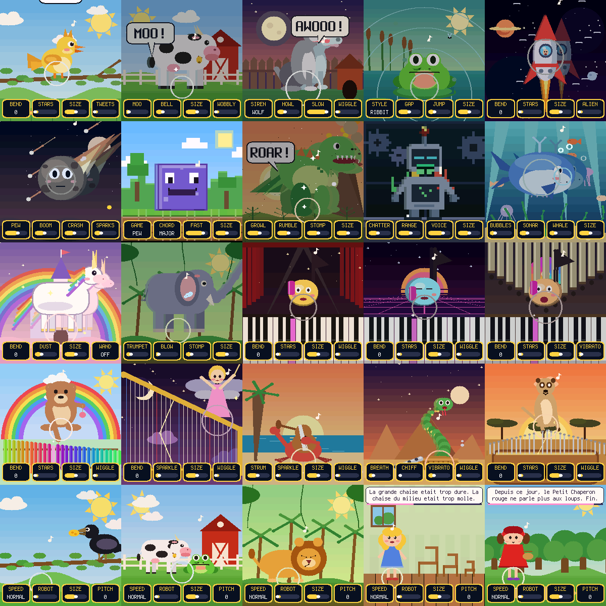

<p align="center"></p>

# LILA

A polyphonic toy synth for a very young musician, as custom firmware for the [M-VAVE FM-1](https://www.m-vave.com).
Built for Lila, on the hardware layer of [fm1-tribe](../fm1-tribe) (X0X, Felucca).

It is a normal synth underneath: ten voices, two oscillators and a sub, an FM partner, a filter, an envelope, an LFO,
echo, reverb, chorus and a robot crusher. On top, it is a toy: **twelve worlds** (a bird, a cow, a dog, a frog, a
spaceship, meteors, a block world, dinosaurs, a robot, the ocean, a fairy castle and the jungle). Each world is its own
instrument *and* its own animated picture, with **its own knobs** (the dog howls or sounds a police siren, the frog croaks, the
arcade has a chip arpeggio, the whale sings and pings), and **whatever knob is turned, the picture changes with it**: more echo
leaves ghosts, more filter makes the world brighter, the robot knob turns everything into big square pixels, the size knob
makes the animal grow.



Every button has one page and the four knobs always do something. The keys just play. See the **[manual](docs/MANUAL.md)**.

| | |
|---|---|
| Keys, OCT- / OCT+ | play, change octave |
| PRESETS | pick the world |
| ALGORITHM | the mood: sunny, night, magic, crazy |
| SELECT | pick the song, while one plays |
| MASTER | volume |
| FX SEL ENV LFO EDIT | the sound: effects, filter, envelope, wobble, shape |
| HOME | the magic knobs: bend, stars, size, wiggle |
| GLO | the party: tempo, key, easy notes, friends (chords) |
| ARP | arpeggiator |
| SEQ | a drum beat to play along to |
| PLAY / STOP | twelve songs: listen, or let the keys light up and follow them |
| REC | record a tune and loop it, even slowed down or sped up |
| SAVE | eight treasure boxes for favourite sounds |

## Build and try

```
tests/run_tests.sh      # the audio on every world, then the whole app scripted in a simulator (screenshots in build/scen/)
desktop/build.sh        # a window with sound (needs SFML 2.x): build/desktop/lila
python3 tools/build.py  # the firmware package build/lila.fwsc (needs the JieLi toolchain and SDK: BUILDING.md)
tools/flash.sh --build  # check that an FM-1 answers; add --yes to install it
```

See [BUILDING.md](BUILDING.md). Installing firmware is at your own risk; LILA has not been run on a real FM-1 yet.

GPL-3.0-only. See [LICENSING.md](LICENSING.md) for where the parts come from. M-VAVE and FM-1 are trademarks of their owners.
